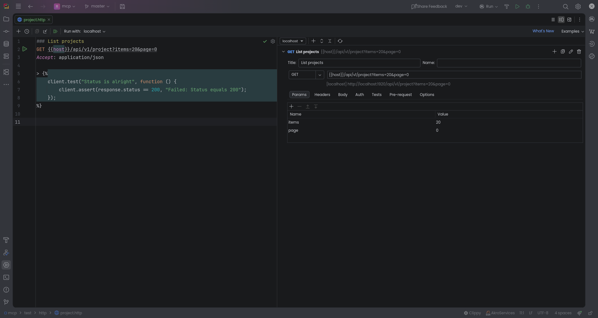

# intellij-http-gui

> [!info] This plugin was written 100% by Claude on a rainy Sunday evening. It works on my machine, and you're welcome to use it as well, but don't expect me to maintain it. Feel free to report or even fix bugs you find though. 



**HTTP Request Designer** is an IntelliJ plugin that adds a graphical designer to IntelliJ HTTP Client files
(`.http` / `.rest`). The file opens with the text editor and the designer side by side; the buttons in the editor's
top-right corner switch between text only, split and designer only (like the Markdown editor). Both halves edit the
same document: changes in the designer rewrite only the affected request, and changes made anywhere else (the text
editor, VCS, external tools) show up in the designer live. Requests are still run from the text editor's gutter.

The designer is laid out like a notebook: every request in the file is a collapsible section in one scrolling
column, with its actions (add below, duplicate, show in text, delete) in the section's toolbar.

## Features

| | |
|---|---|
| **Requests** | One collapsible section per request (duplicate, delete, jump to the text); add requests with the HTTP Client's own **+** in the editor toolbar and they appear live. Method picker with the standard methods in their usual colours (plus `GRAPHQL` / `WEBSOCKET`) that also accepts any custom method. URL, query parameter and header tables, and a body editor highlighted according to its `Content-Type`. Expand / Collapse All live in the HTTP Client's editor toolbar. |
| **OpenAPI routes** | Routes are offered as completions in the URL field (type a path such as `/pe`, a method, or press Ctrl+Space). They come from the IDE's **Endpoints** view (`com.intellij.microservices.endpointsProvider`, which the OpenAPI/Swagger and framework plugins feed) and from OpenAPI/Swagger files in the project, and are refreshed when those files change. Picking a route fills in method, path (`{id}` → `{{id}}`), query parameters, content type, an example body and a default status test. |
| **Environment completion** | Type `{{` in the URL, header and parameter fields to complete variables from `http-client.env.json` / `http-client.private.env.json` (including `$shared`), in-file `@variables` and the built-in dynamic variables. The designer follows the environment chosen in the HTTP Client's *Run with* selector, shows a resolved preview of the URL and flags undefined variables. |
| **Authentication** | *Environment Authentication…* in the editor toolbar manages the OAuth 2.0 configurations (`Security.Auth`) of each environment: only the fields the chosen grant type needs, endpoints filled in by OpenID Connect discovery, secrets kept in the private env file. A request ticks **Use environment authentication** to use the configuration marked as the environment default (the same name in every environment, so switching *Run with* switches credentials), or picks its own scheme: Basic, Digest, Bearer, API key (header or query), a specific OAuth 2.0 configuration or a custom `Authorization` value. |
| **Tests** | The response handler (`> `) and pre-request script (`< `) are JavaScript editors with the HTTP Client's own completion for `client`, `response` and `request`. New requests start with an example test. |
| **More** | Pre-request scripts, request tags (`@no-redirect`, `@no-cookie-jar`, `@no-log`, `@timeout`, ...) and HTTP version. |

## Project layout

- `core/` — plain Kotlin, no IntelliJ dependency: `.http` parser/serializer, query-string handling, test-script
  generation/recognition, auth header codec, environment files (JSON) and OpenAPI route extraction. Unit tested.
- `src/` — the IntelliJ plugin: `HttpGuiEditorProvider` (text editor + designer split), `HttpGuiFileEditor` (the
  notebook, document sync and live reload), `ui/` (request cards and forms) and `services/` (environment files, routes).
- `samples/` — an `.http` file, environment file and OpenAPI spec to try the designer with.

## Installing

Download `intellij-http-gui-<version>.zip` from the [latest release](https://github.com/J-Cake/intellij-http-gui/releases/latest)
and install it with *Settings → Plugins → ⚙ → Install Plugin from Disk…* (don't unpack the ZIP).

To get updates automatically, add this custom plugin repository under *Settings → Plugins → ⚙ → Manage Plugin
Repositories…* and install "HTTP Request Designer" from the Marketplace tab:

```
https://github.com/J-Cake/intellij-http-gui/releases/latest/download/updatePlugins.xml
```

## Building

Requires JDK 21.

```bash
./gradlew :core:test      # unit tests for the format logic
./gradlew buildPlugin     # plugin ZIP in build/distributions
./gradlew runIde          # sandbox IDE with the plugin installed
```

The IDE version used for compiling is `platformVersion` in `gradle.properties`; the plugin supports builds from
`pluginSinceBuild` (2024.3) on. To build against an IDE that is already unpacked locally instead of downloading one,
pass `-PplatformLocalPath=/path/to/idea`. The HTTP Client itself is part of IntelliJ IDEA Ultimate (and other paid
JetBrains IDEs), so that's where requests can be run; the designer doesn't depend on it.

## Continuous integration and releases

- `.github/workflows/build.yml` runs the unit tests and builds the plugin ZIP on pushes to `master` and on pull
  requests; the ZIP is attached to the run as an artifact.
- `.github/workflows/release.yml` publishes a release. Push a version tag (`git tag v0.2.0 && git push origin v0.2.0`)
  or run the workflow manually with a version. The plugin is built with that version and the release gets the ZIP
  plus the `updatePlugins.xml` used by the custom plugin repository above.
